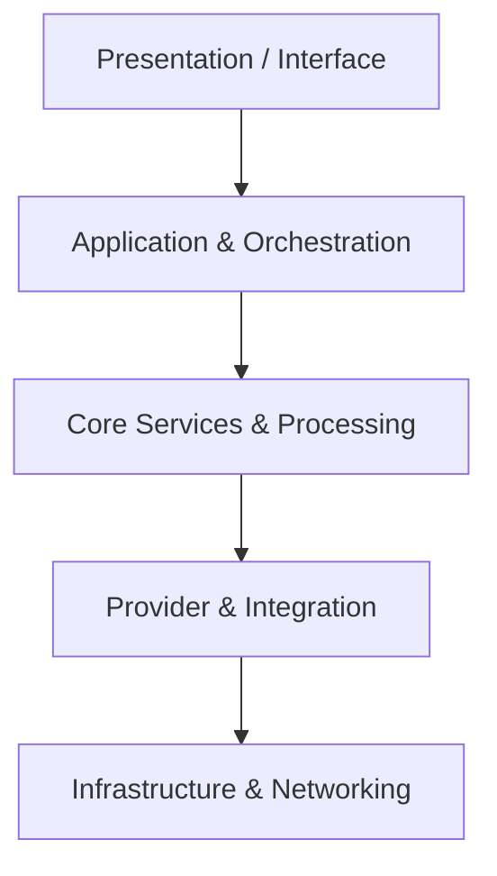

# Architecture Specification

> Generated by openlore v1.2.0 on 2026-10-07 15:16

## Purpose

This document describes the architectural patterns and structure of the system.

## Architecture Style

Layered architecture: Presentation layers (CLI and Elm-architecture TUI) delegate to application
orchestration and core services (Downloader, ArchiveService, LibraryService), which interact with
domain models, HTTP client policies, and external provider adapter implementations.

## Requirements

### Requirement: LayeredArchitecture

The system SHALL maintain separation between:
- Presentation / Interface (Command-line parsing, argument dispatching, and interactive terminal UI state management and rendering)
- Application & Orchestration (Bootstrapping components, orchestrating workflows between CLI/TUI and providers, and managing the download queue)
- Core Services & Processing (Downloading pages with concurrency/rate-limiting control, directory/library management, CBZ archiving, and metadata parsing)
- Provider & Integration (Registration, lookup, and provider-specific scraping/API adapters for webcomic platforms)
- Infrastructure & Networking (HTTP client constraints, URL policy validation, and security rule enforcement)

#### Scenario: LayerSeparation
- **GIVEN** a request from the presentation layer
- **WHEN** business logic is needed
- **THEN** the presentation layer delegates to the business layer
- **AND** direct database access from presentation is prohibited

### Requirement: SecurityModel

The system SHALL implement security via: Strict outbound request validation via URLPolicy, which validates provider-supplied URLs to enforce constraints including permitted schemes, hostnames, allowed ports, and blocking credentials or URL fragments. No end-user authentication or authorization is present in the codebase evidence, as this is a local client application.

#### Scenario: AuthenticatedAccess
- **GIVEN** an unauthenticated request
- **WHEN** accessing protected resources
- **THEN** access is denied

## System Diagram

## Layer Structure

### Presentation / Interface

**Purpose**: Command-line parsing, argument dispatching, and interactive terminal UI state management and rendering
**Location**: `App (cli), TUIModel (tui), TUIService (tui), TUIModelUpdateService (tui), TUIViewRenderer (tui), MouseInputHandler (tui), HeadlessCliLessonQuiz (lessons), LessonQuizService (lessons), CbzArchivesLesson (lessons)`

### Application & Orchestration

**Purpose**: Bootstrapping components, orchestrating workflows between CLI/TUI and providers, and managing the download queue
**Location**: `LabradorApplication (labrador), QueuePersistenceService (tui)`

### Core Services & Processing

**Purpose**: Downloading pages with concurrency/rate-limiting control, directory/library management, CBZ archiving, and metadata parsing
**Location**: `Downloader (downloader), ArchiveService (archive), LibraryService (domain/archive), ChapterParserService (domain)`

### Provider & Integration

**Purpose**: Registration, lookup, and provider-specific scraping/API adapters for webcomic platforms
**Location**: `Registry (provider), ProviderRegistryService (provider), PrivateProvidersRegistrar (provider), MangaDexProvider (providers), MangaKatanaProvider (providers), ManganatoProvider (providers), ManganeloProvider (providers), MangapillProvider (providers), ReadComicsOnlineProvider (providers), WebtoonsProvider (providers), WeebCentralProvider (providers)`

### Infrastructure & Networking

**Purpose**: HTTP client constraints, URL policy validation, and security rule enforcement
**Location**: `URLPolicy (httpclient)`

## Data Flow

User commands/interactions originate in the CLI (e.g., runFetch, runChapters) or TUI (Update/View) →
dispatched via LabradorApplication/App → Provider registry invokes specific provider adapter (e.g.,
MangaDex, Webtoons) to fetch series metadata and chapter page URLs → validated through URLPolicy →
Downloader fetches chapter image assets with provider concurrency throttling → ArchiveService writes
images and generated ComicInfo.xml into atomic CBZ archive files on disk; queue state is cached via
QueuePersistenceService.

## External Integrations

| System | Purpose |
|--------|---------|
| MangaDex API | External integration |
| MangaKatana | External integration |
| Manganato | External integration |
| Manganelo | External integration |
| MangaPill | External integration |
| ReadComicsOnline | External integration |
| Webtoons | External integration |
| WeebCentral | External integration |
| Local Filesystem (CBZ archives and disk queue cache) | External integration |
